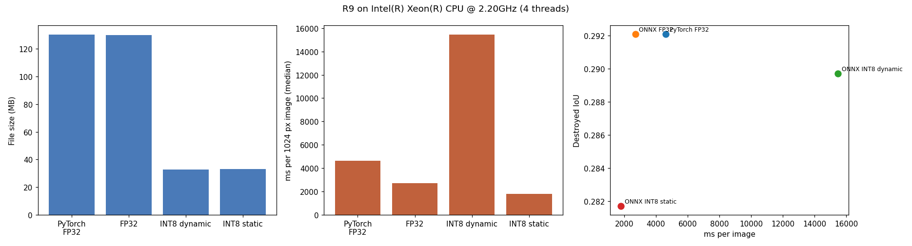
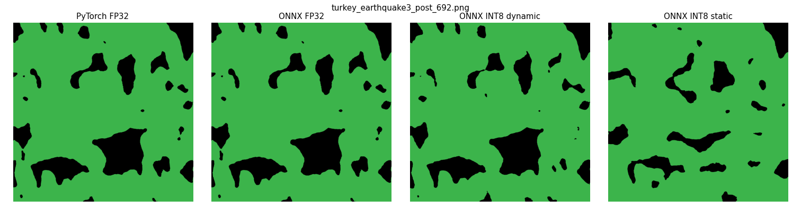

# L1: edge benchmark of the R9 U-Net

Machine: Intel(R) Xeon(R) CPU @ 2.20GHz, 4 threads, 33.7 GB RAM (Linux-6.18.48+-x86_64-with-glibc2.39). onnxruntime 1.31.0, torch 2.11.0+cpu.

Accuracy on 645 validation images (standard prediction, no TTA); speed as the median of 3 timed runs per image on 50 images. RAM is the growth of the process memory while the variant ran (approximate).

| variant           |   file_mb |   ram_mb |   ms_per_image |   ms_p95 |   speedup_vs_pytorch |   miou |   destroyed_iou |   destroyed_drop |   pixel_agreement_with_pytorch | int8_usable   |
|:------------------|----------:|---------:|---------------:|---------:|---------------------:|-------:|----------------:|-----------------:|-------------------------------:|:--------------|
| PyTorch FP32      |     130.4 |        3 |           4632 |     4808 |                 1    | 0.5373 |          0.2921 |           0      |                         1      |               |
| ONNX FP32         |     130   |      520 |           2707 |     2852 |                 1.71 | 0.5373 |          0.2921 |          -0      |                         1      |               |
| ONNX INT8 dynamic |      32.7 |     1052 |          15468 |    16369 |                 0.3  | 0.5358 |          0.2897 |           0.0024 |                         0.9952 | yes           |
| ONNX INT8 static  |      33.1 |      151 |           1801 |     1949 |                 2.57 | 0.5251 |          0.2817 |           0.0104 |                         0.9876 | no            |

INT8 counts as usable if Destroyed IoU drops by less than 0.01 against PyTorch FP32.

Files: `edge_benchmark.csv`, the three `.onnx` models, `config.json`.