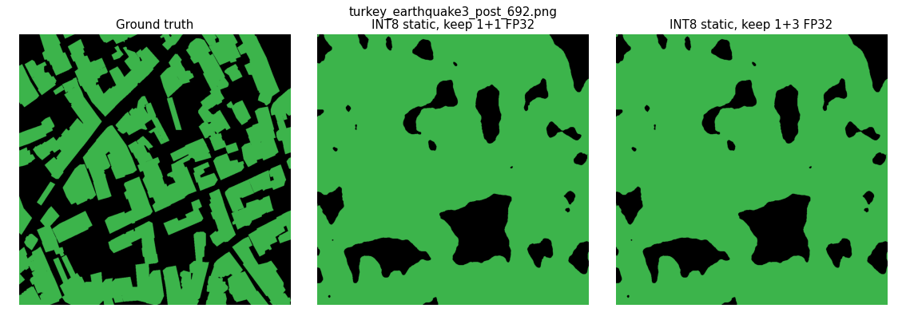

# L1b: static INT8, second try

Machine: Intel(R) Xeon(R) CPU @ 2.20GHz, 4 threads, 33.7 GB RAM (Linux-6.18.48+-x86_64-with-glibc2.39). onnxruntime 1.31.0, torch 2.11.0+cpu.

Same R9 export and static INT8 recipe as L1 (QDQ, per-channel weights, ranges from 100 training images), with a few convolutions kept in FP32. Accuracy on 645 validation images (standard prediction, no TTA); speed as the median of 3 timed runs per image on 50 images, with ONNX FP32 timed in the same session. FP32 accuracy comes from L1 (PyTorch FP32 = ONNX FP32).

| variant                      |   file_mb |   ms_per_image |   ms_p95 |   speedup_vs_onnx_fp32 |   miou |   destroyed_iou |   destroyed_drop | int8_usable   |
|:-----------------------------|----------:|---------------:|---------:|-----------------------:|-------:|----------------:|-----------------:|:--------------|
| ONNX FP32 (accuracy from L1) |     130   |           2289 |     2309 |                   1    | 0.5373 |          0.2921 |           0      |               |
| INT8 static, keep 1+1 FP32   |      33.1 |           1651 |     1660 |                   1.39 | 0.5363 |          0.2918 |           0.0003 | yes           |
| INT8 static, keep 1+3 FP32   |      33.1 |           1601 |     1621 |                   1.43 | 0.5363 |          0.2918 |           0.0003 | yes           |

**Verdict:** Edge model: INT8 static, keep 1+3 FP32, 1.43x the speed of ONNX FP32, Destroyed IoU drop 0.0003 (limit 0.01).

For comparison, L1's static INT8 with every layer in INT8: mIoU 0.5251, Destroyed IoU 0.2817, drop 0.0104, so not usable.

Convolutions kept in FP32:

- INT8 static, keep 1+1 FP32: /encoder/conv1/Conv, /segmentation_head/segmentation_head.0/Conv
- INT8 static, keep 1+3 FP32: /encoder/conv1/Conv, /decoder/blocks.4/conv1/conv1.0/Conv, /decoder/blocks.4/conv2/conv2.0/Conv, /segmentation_head/segmentation_head.0/Conv

Files: `int8_retry.csv`, the two static INT8 `.onnx` files, `config.json`. `r9_fp32.onnx` is not repeated here: it is the same file as L1's.