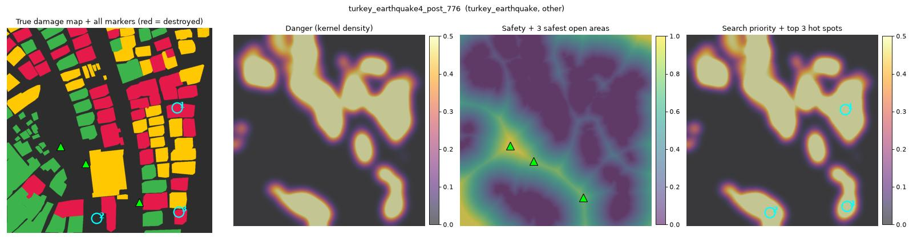
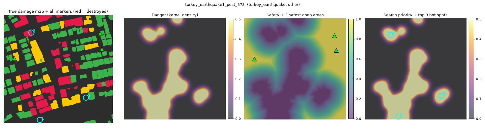
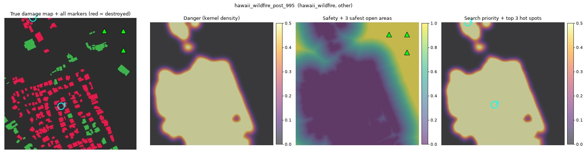
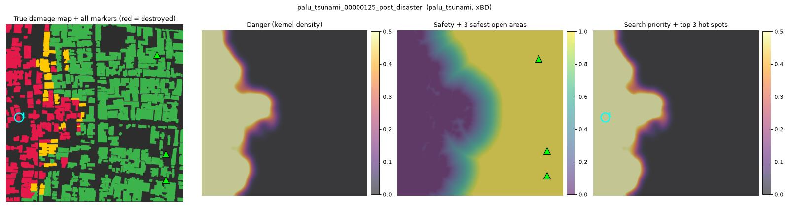
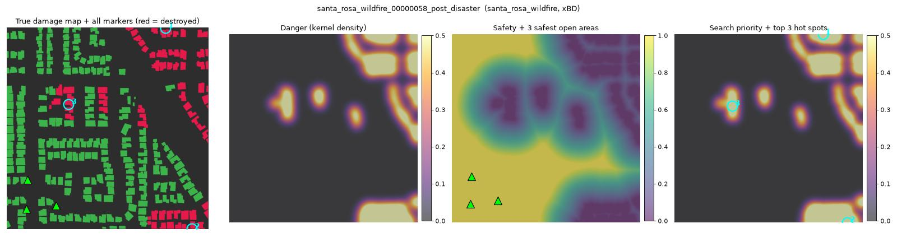
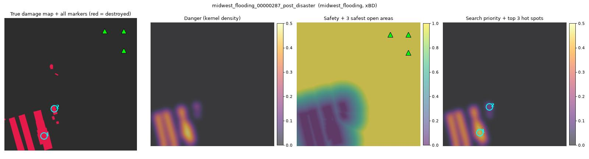

# T1 v2 survivability heatmap

645 validation images, maps from R9's predicted masks (`R9_tta`), run on a PC. The maps are the same as v1's. Three fixes: each hot spot is marked at its strongest point, zones under 500 px are ignored, and safe areas stay 100 px from the image edge.

## The 20 checked images: v1 against v2

```
on the 20 checked images  v1  v2
                 circles  48  46
      point_on_destroyed  26  31
         point_on_damage  36  39
              safe_areas  57  57
safe_within_50px_of_edge  52   0
        safe_on_building   9   4
```

- `point_on_destroyed`, `point_on_damage`: hot spots whose marked point is within 20 px of a ground-truth destroyed (damaged or destroyed) building. v1's numbers come from the 19 Oct check of its overlays, with the same tests.
- `safe_within_50px_of_edge`, `safe_on_building`: safe areas on the image edge, and on a ground-truth building.

## Hot spots against the ground truth (all images)

```
   images_from source  images  hot_spots  on_gt_destroyed  ceiling_from_gt_mask  on_gt_damaged_or_destroyed  point_on_gt_destroyed  point_on_gt_damage  safe_on_gt_building
           all    all     645        694            0.349                 0.466                       0.778                  0.282               0.736                0.028
           all  other      85         48            0.500                 0.432                       0.625                  0.417               0.479                0.167
           all    xBD     560        646            0.337                 0.470                       0.789                  0.272               0.755                0.017
with destroyed    all     216        397            0.610                 0.732                       0.897                  0.494               0.846                0.021
with destroyed  other      22         31            0.774                 0.704                       0.871                  0.645               0.677                0.125
with destroyed    xBD     194        366            0.596                 0.735                       0.899                  0.481               0.861                0.012
```

- `on_gt_destroyed`, `on_gt_damaged_or_destroyed`: share of hot spots whose zone touches ground-truth destroyed (damaged or destroyed) pixels, as in v1. Read `on_gt_destroyed` against `ceiling_from_gt_mask`, the same share when the maps come from the ground-truth mask.
- `point_on_gt_destroyed`, `point_on_gt_damage`: the same for the marked point itself (within 20 px).
- `safe_on_gt_building`: share of safe areas that sit on a ground-truth building.

## The 20 images to check by eye

```
                                         image source  gt_destroyed_px  hot_spots  point_on_gt_destroyed  point_on_gt_damage  safe_on_gt_building
               turkey_earthquake4_post_776.png  other           186426          3                      2                   2                    0
               turkey_earthquake1_post_573.png  other           120696          3                      1                   1                    1
                  hawaii_wildfire_post_995.png  other           114135          2                      1                   1                    0
               turkey_earthquake4_post_785.png  other            91234          1                      1                   1                    1
               turkey_earthquake4_post_764.png  other            56812          3                      3                   3                    0
               turkey_earthquake4_post_727.png  other            53256          3                      1                   1                    0
               turkey_earthquake1_post_596.png  other            36996          1                      1                   1                    0
               turkey_earthquake0_post_380.png  other            31140          1                      1                   1                    1
               turkey_earthquake1_post_577.png  other            17006          2                      2                   2                    1
               turkey_earthquake4_post_779.png  other            16396          3                      2                   2                    0
       palu_tsunami_00000125_post_disaster.png    xBD           128736          1                      1                   1                    0
santa_rosa_wildfire_00000058_post_disaster.png    xBD            70825          3                      3                   3                    0
   midwest_flooding_00000287_post_disaster.png    xBD            53449          2                      2                   2                    0
   hurricane_harvey_00000406_post_disaster.png    xBD            37043          3                      1                   3                    0
      moore_tornado_00000033_post_disaster.png    xBD            28627          3                      2                   3                    0
      moore_tornado_00000140_post_disaster.png    xBD            26830          3                      2                   3                    0
 lower_puna_volcano_00000091_post_disaster.png    xBD            26574          0                      0                   0                    0
      moore_tornado_00000120_post_disaster.png    xBD            25405          3                      2                   3                    0
      moore_tornado_00000029_post_disaster.png    xBD            22444          3                      3                   3                    0
   hurricane_harvey_00000394_post_disaster.png    xBD            21399          3                      0                   3                    0
```

## Examples (3 xBD, 3 other)













## Files

- `hotspots.json`: per image, the top 3 hot spots (marked point, area, peak, compass position, ground-truth checks) and the 3 safest open areas (point, distance to damage, distance to the edge, compass position, ground-truth check)
- `maps/<name>_{kde,safe,priority}.png`: 256 x 256, value x 255
- `overlays/<name>.jpg`, `T1_summary.csv`, `T1_per_image.csv`, `config.json`