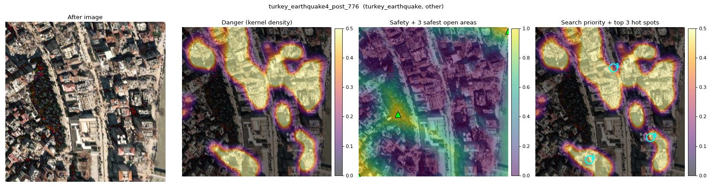
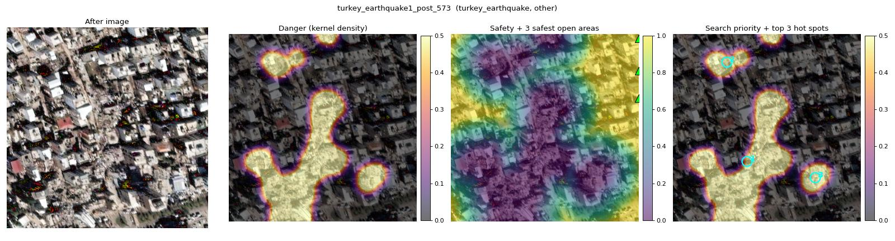
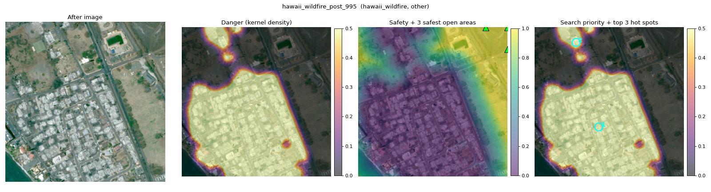
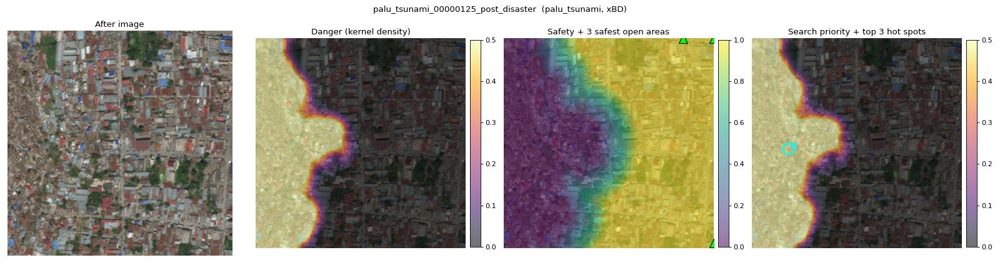
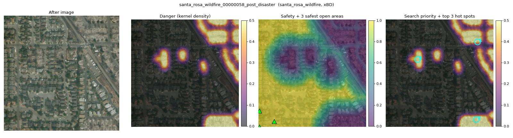
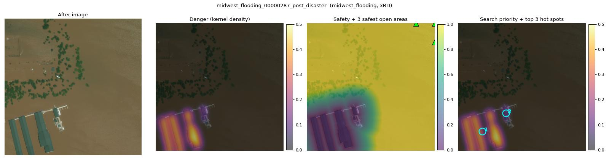

# T1 survivability heatmap

645 validation images, maps from R9's predicted masks (`R9_tta`). Danger = GaussianBlur(1.0 x destroyed + 0.5 x damaged, sigma 25 px); safety = min(distance to damage / 200 px, 1); priority = danger x (1 - safety); hot spots = connected regions with priority >= 0.05.

## Hot spots against the ground truth

| images_from    | source   |   images |   hot_spots |   on_gt_destroyed |   ceiling_from_gt_mask |   on_gt_damaged_or_destroyed |
|:---------------|:---------|---------:|------------:|------------------:|-----------------------:|-----------------------------:|
| all            | all      |      645 |         708 |             0.345 |                  0.47  |                        0.768 |
| all            | other    |       85 |          50 |             0.48  |                  0.432 |                        0.6   |
| all            | xBD      |      560 |         658 |             0.334 |                  0.475 |                        0.781 |
| with destroyed | all      |      216 |         404 |             0.604 |                  0.734 |                        0.886 |
| with destroyed | other    |       22 |          33 |             0.727 |                  0.704 |                        0.818 |
| with destroyed | xBD      |      194 |         371 |             0.593 |                  0.738 |                        0.892 |

- `on_gt_destroyed`: share of hot spots that touch ground-truth destroyed pixels.
- `ceiling_from_gt_mask`: the same share when the maps come from the ground-truth mask. It is below 100% because damaged areas also make hot spots, so read `on_gt_destroyed` against it.
- `on_gt_damaged_or_destroyed`: share of hot spots that touch damaged or destroyed pixels (ceiling 100%).

## The 20 images to check by eye

| image                                          | source   |   gt_destroyed_px |   hot_spots |   on_gt_destroyed |
|:-----------------------------------------------|:---------|------------------:|------------:|------------------:|
| turkey_earthquake4_post_776.png                | other    |            186426 |           3 |                 3 |
| turkey_earthquake1_post_573.png                | other    |            120696 |           3 |                 2 |
| hawaii_wildfire_post_995.png                   | other    |            114135 |           2 |                 2 |
| turkey_earthquake4_post_785.png                | other    |             91234 |           2 |                 1 |
| turkey_earthquake4_post_764.png                | other    |             56812 |           3 |                 3 |
| turkey_earthquake4_post_727.png                | other    |             53256 |           3 |                 2 |
| turkey_earthquake1_post_596.png                | other    |             36996 |           1 |                 1 |
| turkey_earthquake0_post_380.png                | other    |             31140 |           1 |                 1 |
| turkey_earthquake1_post_577.png                | other    |             17006 |           3 |                 2 |
| turkey_earthquake4_post_779.png                | other    |             16396 |           3 |                 2 |
| palu_tsunami_00000125_post_disaster.png        | xBD      |            128736 |           1 |                 1 |
| santa_rosa_wildfire_00000058_post_disaster.png | xBD      |             70825 |           3 |                 3 |
| midwest_flooding_00000287_post_disaster.png    | xBD      |             53449 |           2 |                 2 |
| hurricane_harvey_00000406_post_disaster.png    | xBD      |             37043 |           3 |                 3 |
| moore_tornado_00000033_post_disaster.png       | xBD      |             28627 |           3 |                 2 |
| moore_tornado_00000140_post_disaster.png       | xBD      |             26830 |           3 |                 2 |
| lower_puna_volcano_00000091_post_disaster.png  | xBD      |             26574 |           0 |                 0 |
| moore_tornado_00000120_post_disaster.png       | xBD      |             25405 |           3 |                 2 |
| moore_tornado_00000029_post_disaster.png       | xBD      |             22444 |           3 |                 3 |
| hurricane_harvey_00000394_post_disaster.png    | xBD      |             21399 |           3 |                 3 |

## Examples (3 xBD, 3 other)

## Files

- `hotspots.json`: per image, the top 3 hot spots (centroid, area, peak, compass position, ground-truth check) and the 3 safest open areas (point, distance to damage, compass position)
- `maps/<name>_{kde,safe,priority}.png`: 256 x 256, value x 255
- `overlays/<name>.jpg`, `T1_summary.csv`, `T1_per_image.csv`, `config.json`